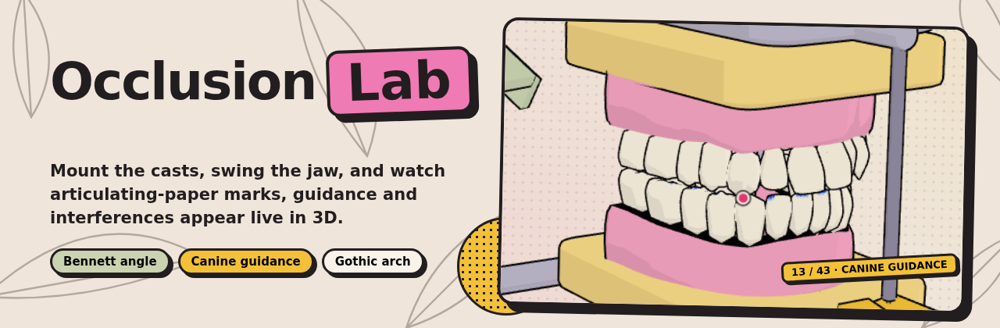
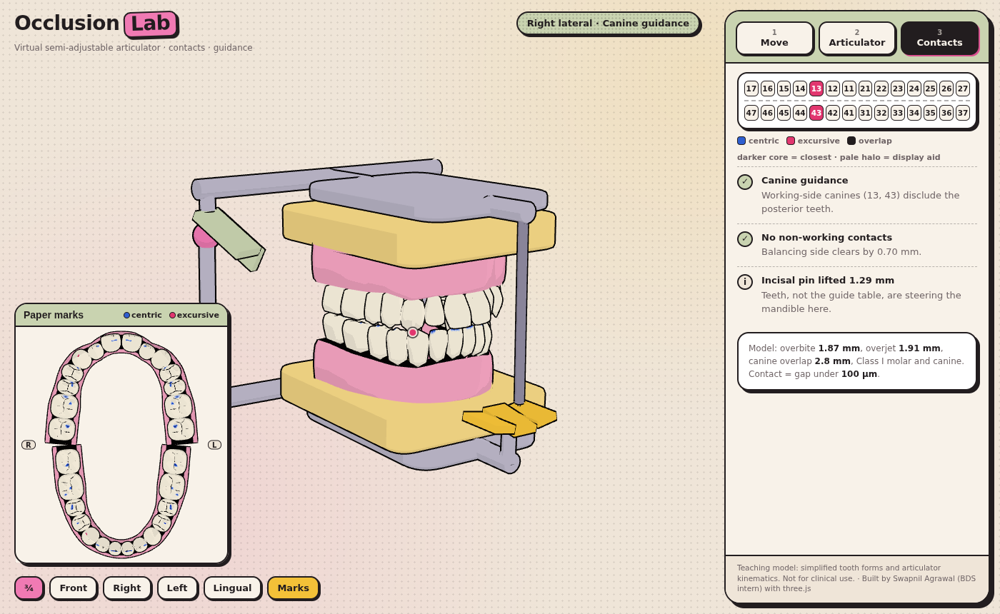
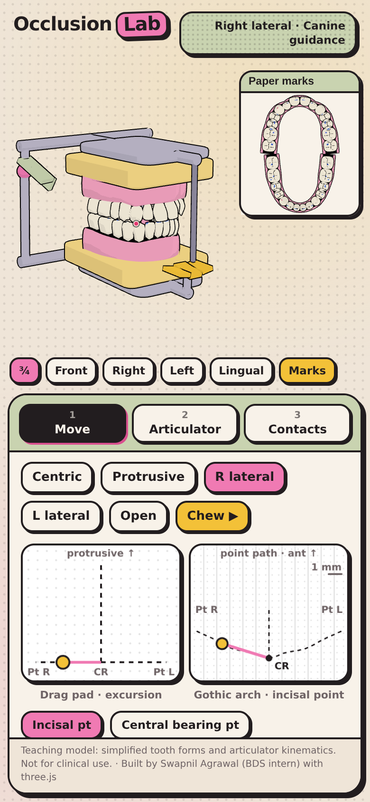
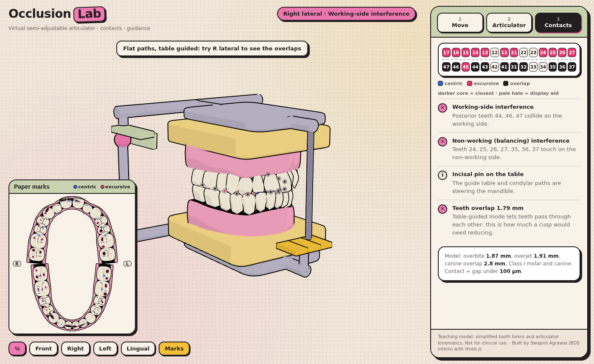
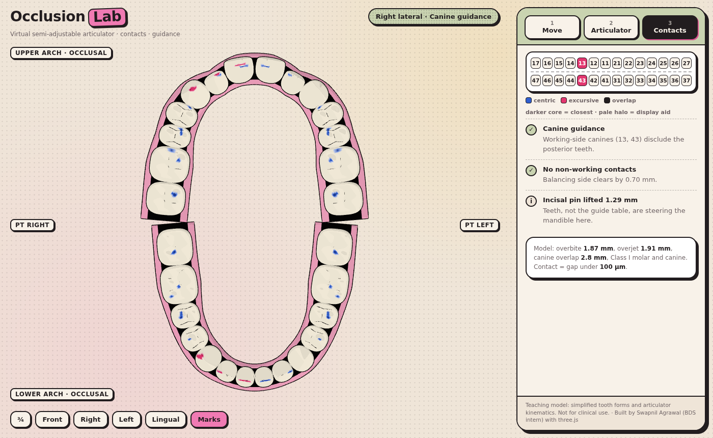

<p align="center"></p>

<p align="center">
  
  
  
  
</p>

<p align="center"><b>Articulating paper, but you can rewind it.</b><br>
Mount two casts on a virtual semi-adjustable articulator, swing the mandible, and watch every contact, guidance and interference light up in 3D.</p>

---

## 🦷 Why this exists

Every prostho student hears "steeper condylar path, more posterior disclusion" and nods. Very few ever <i>see</i> it. On a real articulator you get one set of marks, smudged, and then the paper's gone.

Occlusion Lab lets you change one setting and watch the marks change with it. Flatten the condylar path and the balancing interferences appear on 24 to 27. Steepen it and they vanish. That's the whole lecture, in five seconds.

## 🎮 Try this in 60 seconds

| | Do this | Watch for |
|---|---|---|
| **1** | Press **R lateral** | Red marks on **13 / 43** only. The badge reads <b>Canine guidance</b>; the incisal pin lifts 1.29 mm |
| **2** | Open **Marks** | Both arches open like a book: blue centric stops, red excursive marks |
| **3** | Articulator tab → **Flat paths, table only** | Working-side interference on 44, 46, 47 and balancing interference on 24 to 27 and 35 to 37, with the overlap depth |
| **4** | Drag the **Bennett angle** slider | The non-working path swings and the contacts move with it |
| **5** | Press **Chew ▶** | A full chewing cycle, with the Gothic arch tracing drawn live |

## 📸 Screens

<table>
<tr>
<td width="68%"><br><sub><b>Right lateral</b> · canine guidance on 13/43, posteriors discluded, live paper-marks inset</sub></td>
<td width="32%" rowspan="2"><br><sub><b>Phone</b> · drag pad and bottom sheet, works one-handed</sub></td>
</tr>
<tr>
<td><br><sub><b>Flat paths</b> · working and balancing interferences flagged, black overlap = what you'd have to grind</sub></td>
</tr>
<tr>
<td colspan="2"><br><sub><b>Marks view</b> · the occlusal map you'd get from articulating paper, with the guidance verdict beside it</sub></td>
</tr>
</table>

## ✨ What's inside

- **A real kinematic model**: condylar inclination, Bennett angle and an incisal guide table drive the mandible; the working condyle rotates and shifts, the non-working one travels down, forward and in
- **Teeth guide toggle**: on, the jaw rides on whichever teeth touch first; off, only the articulator steers, so collisions show up as black overlaps with depth in mm
- **Articulating paper you can tune**: 20 to 200 µm. Blue centric, red excursive, black overlap, darker core where the gap is smallest
- **Plain-language verdicts**: canine guidance, group function, anterior guidance, working-side and non-working interferences, pin lift
- **FDI dental chart** that lights up the teeth in contact
- **Gothic arch tracing** from the incisal point or a central bearing point, plate on upper or lower
- **Chew ▶ demo** and a free **drag pad** for any excursion in between
- **Ink-pop look** throughout: toon shading, inked outlines, cream paper, halftone

> ⚠️ **Teaching model, not for clinical use.** Tooth forms are simplified and the kinematics are idealised. Every clinical assumption is listed, with where it lives in the code, in [NOTES.md](NOTES.md).

## 🚀 Run it

Needs Node 18+.

```bash
npm install
npm run dev       # local dev server (Vite)
npm run build     # static build in dist/
npm run preview   # serve the build
```

`dist/` is a plain static site and can be hosted anywhere.

### Screenshots (optional)

`scripts/shot.mjs` serves `dist/` and captures preset states with Playwright (Chromium, SwiftShader WebGL) into `shots/`:

```bash
npm run build
node scripts/shot.mjs              # all shots
node scripts/shot.mjs flat-table   # one shot
```

Each shot has its own timeout (`SHOT_MS`, default 90 s) and a failing shot is logged and skipped. Set `PLAYWRIGHT_MODULE` to point at a Playwright install if it is not at the default path. Test hooks are on `window.__ol` (`go`, `pose`, `setParams`, `view`, `tab`, `summary`, `clearMarks`, `clearTrace`).

## 🗺️ Code map

| File | What it does |
|---|---|
| `src/teeth.js` | Procedural tooth crowns (FDI 1 to 7, both arches) and arch curves |
| `src/model.js` | Builds and seats both arches in centric, gums, reference points |
| `src/heightfield.js` | Rasterised height fields for fast occlusal gap queries |
| `src/engine.js` | Articulator kinematics, contact solve, guidance and interference analysis |
| `src/scene.js` | Toon materials, ink outlines, casts and articulator frame |
| `src/main.js` | UI, paper marks, drag pad, Gothic arch, rendering loop |

Clinical assumptions behind the model are listed in [NOTES.md](NOTES.md).

## 💗 Credit

Concept, dental review and design direction: **Swapnil Agrawal (BDS intern)**.  
Also from the same desk: [RPD Studio](https://github.com/swapagrawal14/rpd-studio), a 3D lab for designing removable partial dentures.

Built with [three.js](https://threejs.org) and [Vite](https://vitejs.dev).
